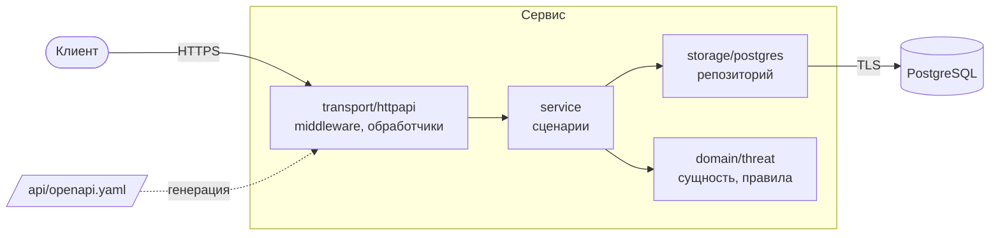

# Архитектура

## Слои

Зависимости направлены к домену: он не знает ни об HTTP, ни о БД. Сервис зависит от
интерфейса `Repository`, а HTTP-слой от интерфейса `ThreatService`, поэтому каждый слой
тестируется отдельно.

| Пакет | За что отвечает |
|---|---|
| `internal/api` | Код из `api/openapi.yaml`. Не редактируется вручную |
| `internal/domain/threat` | Сущность, перечисления, нормализация, бизнес-правила, ошибки |
| `internal/service` | Сценарии `Get`, `Create`, `Replace` |
| `internal/storage/postgres` | Запросы на pgx и встроенные миграции |
| `internal/transport/httpapi` | Обработчики, middleware, единый формат ошибок |
| `internal/auth` | API-ключи и роли |
| `internal/ratelimit` | Token bucket на IP и на ключ |
| `internal/observability` | Метрики и `request_id` в логах |
| `internal/server` | Сборка приложения, TLS, служебный сервер, остановка |
| `internal/config` | Настройки из окружения и их проверка |

## Путь запроса

Запрос проходит middleware в таком порядке:

| # | Шаг | Ответ при отказе |
|---|---|---|
| 1 | Назначение `X-Request-ID`, определение маршрута | |
| 2 | Метрики и access-лог | |
| 3 | Перехват паник | `500` |
| 4 | Заголовки защиты | |
| 5 | Лимит по IP | `429` |
| 6 | Аутентификация по `X-API-Key` | `401` |
| 7 | Лимит по ключу | `429` |
| 8 | Проверка роли | `403` |
| 9 | Лимит размера тела | `413` |
| 10 | Тип содержимого и синтаксис JSON | `415`, `400` |
| 11 | Проверка по OpenAPI | `400`, `404`, `405` |
| 12 | Обработчик, сервис, репозиторий | см. ниже |

Без ключа клиент получает `401` раньше, чем сервер прочитает тело, поэтому ничего не
узнаёт о схеме и адресах.

## Валидация

| Уровень | Что проверяет |
|---|---|
| Спецификация (kin-openapi) | Типы, форматы, длины, enum, лишние поля |
| Домен | То же для любого вызова, плюс правила между полями, диапазон дат, невидимые символы |
| База данных (`CHECK`, `UNIQUE`) | Форматы, перечисления, правила между полями, даже в обход сервиса |

Правила, зависящие от текущего времени и классов Unicode, есть только в домене.

## Ошибки

| Ошибка | Ответ |
|---|---|
| `*ValidationError` | `400` со списком полей |
| `ErrNotFound` | `404` |
| `ErrAlreadyExists`, `ErrHashConflict` | `409` |
| `ErrVersionMismatch` | `412` |
| `ErrPreconditionRequired` | `428` |
| `ErrUnavailable` (нет связи с БД, таймаут) | `503` с `Retry-After` |
| Любая другая | `500`, подробности только в логе |

Обработчики возвращают типизированные ответы из сгенерированного кода, поэтому
необъявленный в спецификации ответ не скомпилируется. HTTP-тесты дополнительно проверяют
каждый ответ по спецификации.

## Конкурентный доступ

- **Создание:** один запрос `INSERT … ON CONFLICT DO NOTHING`, гонки между проверкой и
  вставкой нет.
- **Замена:** один запрос `UPDATE` с проверкой версии. Тест запускает 8 параллельных
  писателей с одной версией, успешен ровно один.
- **История:** триггер пишет каждую версию в той же транзакции, поэтому она не расходится
  с основной таблицей.

## Запуск и остановка

- `migrate` применяет миграции под advisory lock, это безопасно при нескольких репликах.
- `SIGTERM` снимает готовность и даёт запросам завершиться за `HTTP_SHUTDOWN_TIMEOUT`.
- `SIGHUP` перечитывает сертификат TLS и файл API-ключей без перезапуска.
